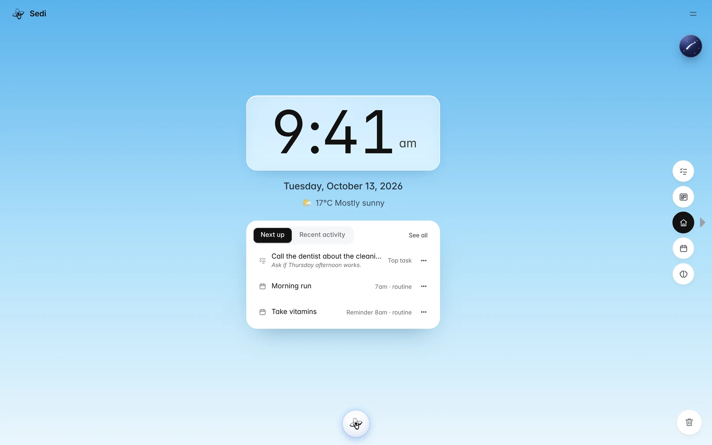
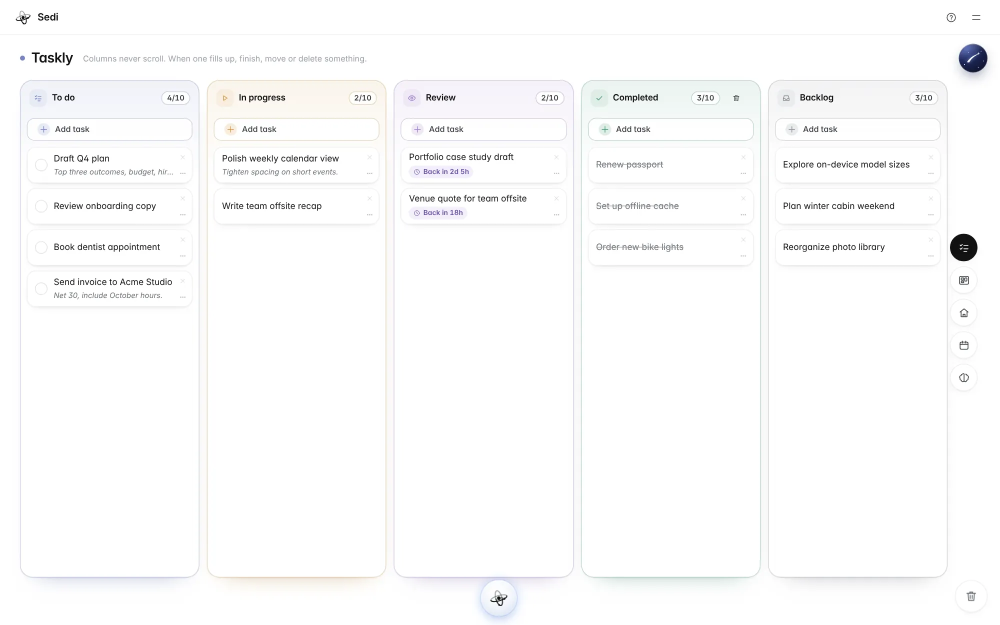
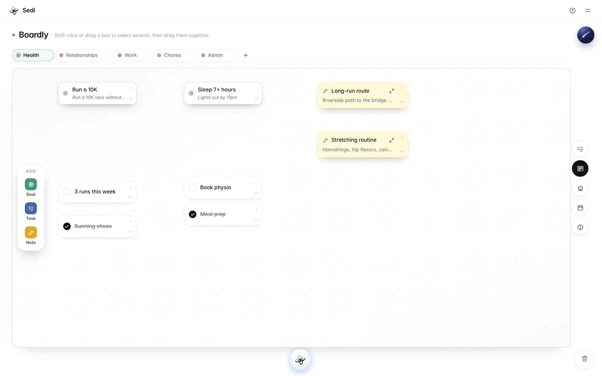
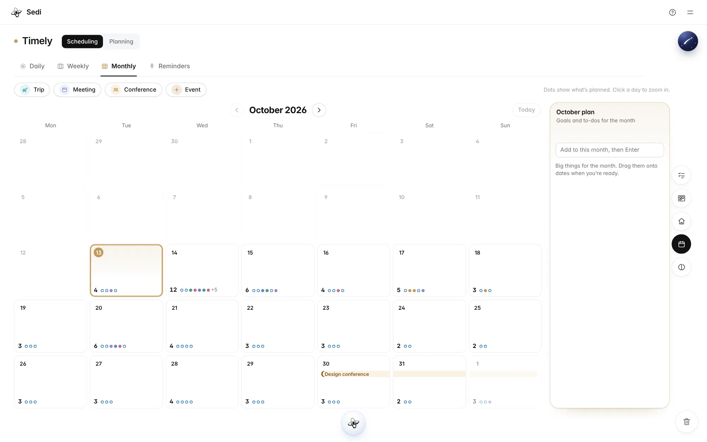
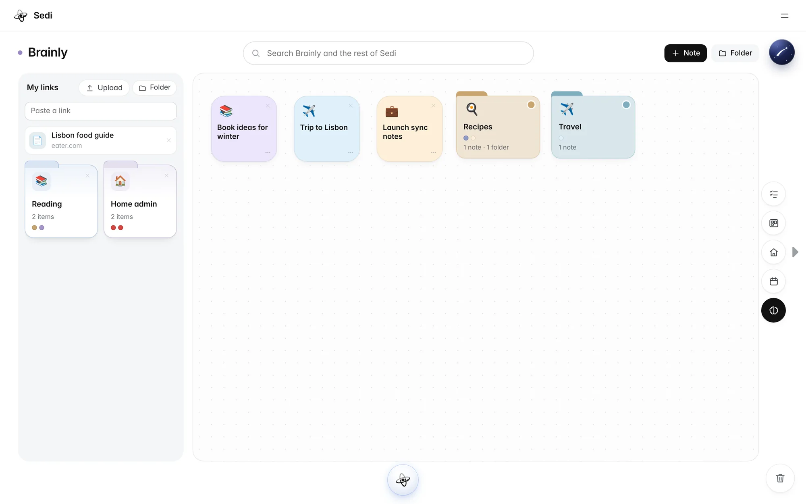

<p align="center">
  
</p>

<h1 align="center">Sedi</h1>

<p align="center">
  <b>Everything in its place.</b><br>
  A calm, focused place to think. Your tasks, goals, calendar and notes in one workspace<br>
  that runs in your browser and works with the tools you already use.
</p>

<p align="center">
  <b>Open Sedi</b> → <a href="https://nweinberg97.github.io/sedi/">nweinberg97.github.io/sedi</a><br>
  <b>About Sedi</b> → <a href="https://nweinberg97.github.io/sedi/welcome/">nweinberg97.github.io/sedi/welcome</a>
</p>

<p align="center">
  
</p>

<p align="center"><sub>Free on the web · No account · Your data stays on your device</sub></p>

---

## Why Sedi

More tools than ever, and more scattered than ever: the calendar in one app, notes in another, goals in your head. Sedi doesn't replace those tools. It gives them a center, a focused room where you think, decide and put things in order, then send them where they belong.

- **Built to connect.** Every task, goal, event, note and link is the same kind of card. A note becomes a task, a goal becomes a plan, a plan goes to your calendar.
- **Designed with limits.** Columns don't scroll and boards have a cap. Less room means clearer choices.
- **Yours.** No sign-up, no server, no ads, no trackers. Sedi works offline after your first visit.

The name comes from Hebrew *seder* (order) and Latin *sedēre* (to sit, to settle): first everything finds its place, then you can see clearly what matters.

## Four tools, one workspace

<table>
  <tr>
    <td width="50%" valign="top">
      
      <b>Taskly</b> · Five columns from To do to Backlog. None of them scroll, so when one fills up you finish, move or let go of something.
    </td>
    <td width="50%" valign="top">
      
      <b>Boardly</b> · A board for each part of your life. Goals, tasks and notes sit wherever you put them; goals open into a SMART template.
    </td>
  </tr>
  <tr>
    <td width="50%" valign="top">
      
      <b>Timely</b> · Day, week and month views, routines, trips across several days, a pinned Reminders board, and planning boards for projects and goals.
    </td>
    <td width="50%" valign="top">
      
      <b>Brainly</b> · Notes, links, PDFs and files, with folders inside folders. Dictate a note, open it as a Google Doc, or turn any link into a task.
    </td>
  </tr>
</table>

## Highlights

| | |
|---|---|
| **Universal Board** | Capture anything in the top corner. Drag it into any tool later and it takes that tool's shape. |
| **Talk to your notes** | Ask about anything you've saved, by typing or speaking (⌘K). Commands create or move cards after you confirm, and every change is logged. |
| **On-device AI** | Runs a small model in your browser, so your words never leave your computer. Or add Claude or any OpenAI-compatible service with your own key. |
| **Calendar** | Add any event to Google Calendar, or export one event or a whole day as `.ics`. |
| **Apple Reminders** | Send any card to Reminders through an Apple Shortcut. |
| **Clear-outs** | Drag a card to the trash, with Undo. Past one-off events archive themselves after 30 days. |
| **Your data** | Menu → Download data saves everything, files included, as one `.json` file. Import brings it back. |

## Links

- **The app:** https://nweinberg97.github.io/sedi/
- **The landing page:** https://nweinberg97.github.io/sedi/welcome/

## Pricing

The Sedi web app is **free, forever**. Native apps for **Mac and iPhone**, with sync between your devices, are in development and will come with a one-time Lifetime Membership. No subscription.

---

<details>
<summary><b>For developers</b></summary>

<br>

Sedi is plain HTML, CSS and JavaScript modules: no framework and no build step. Data lives in IndexedDB (cards and files) and localStorage (settings).

**Run locally:** in this folder, run `python3 -m http.server 8000` and open `http://localhost:8000`. The landing page is at `/welcome/`. Opening `index.html` directly won't work, because browsers block modules for files opened from disk.

**Deploy:** GitHub Pages serves `main` from the repo root. When app files change, bump `VERSION` in `sw.js` so installed copies update.

**Tests:** from `tests/`, run `npm install`, then `npx playwright test`. The smoke suite loads a saved v1 data file to prove old data still opens, then covers creating, editing, dragging, deleting with Undo, reload, export/import and the assistant.

```
index.html, styles.css, app.js   app shell, styles, boot and routing
sw.js                            offline cache
js/store.js                      IndexedDB + localStorage, files, export/import
js/cards.js                      shared card schema, Universal Board, editor
js/dnd.js                        pointer drag engine
js/shell.js                      header, menu, navigator, trash
js/home.js · taskly.js · boardly.js · timely.js · brainly.js   the tools
js/assistant.js · commands.js · engines.js · brain.js           assistant and AI
js/google.js · speech.js         Google Docs/Drive, dictation and voice
welcome/                         landing page
tests/                           Playwright smoke tests (not served)
```

Weather comes from Open-Meteo using your approximate location. In Chrome, dictation uses Google's speech service; spoken replies use voices on your device.

</details>
